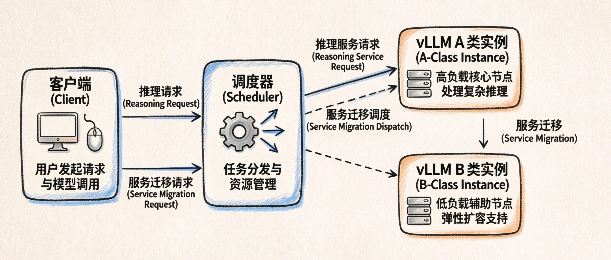
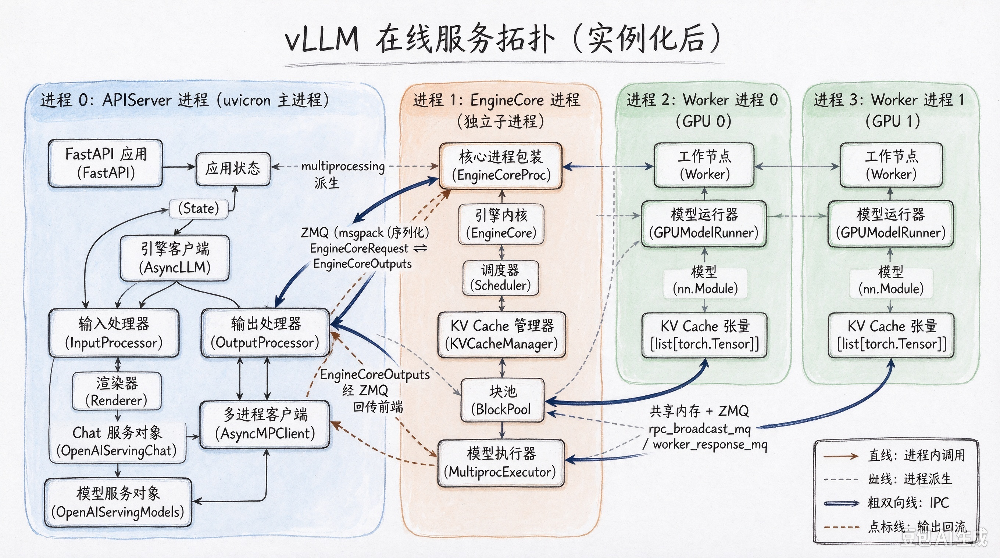
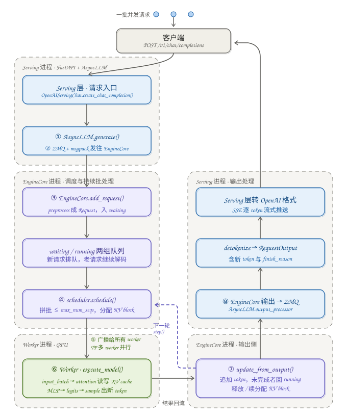
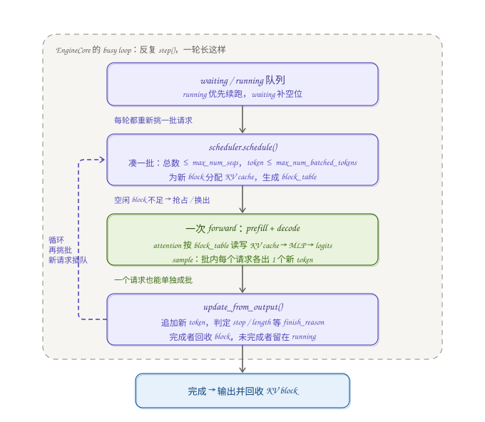
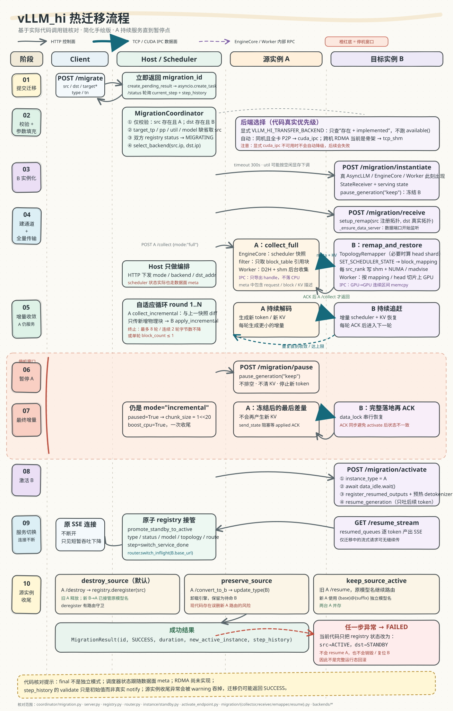
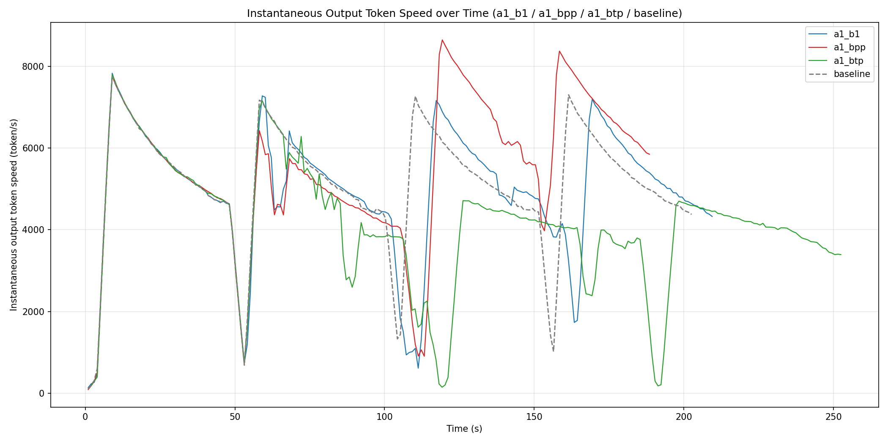
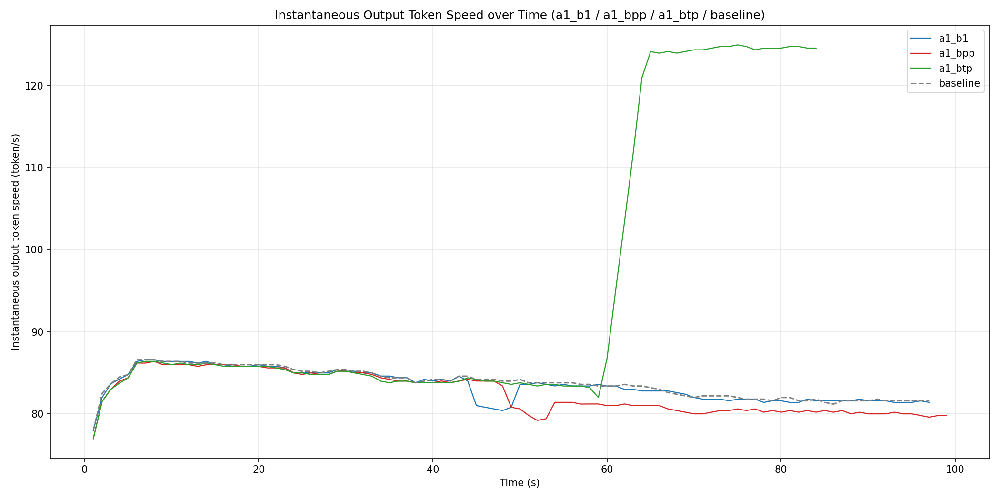

## 一、vLLM_hi 概况
> 一个 vLLM 推理服务热迁移 demo
- 修改 vLLM 实例，分 A 类（原生 vLLM 实例化）和 B 类（standby 实例，只占用通信端口资源）
- 提供调度类，所有推理请求从调度类路由，调度类处理推理服务迁移的请求

    

---

## 二、vLLM 在线服务进程拓扑和实例化情况（vLLM v1 / 0.13）

### 1. vLLM 在线服务进程拓扑
```
┌─ 进程 0：APIServer ─────────────────────────────┐
│  app (FastAPI) ── app.state ── engine_client    │   ← AsyncLLM（A）或占位（B）
│  AsyncLLM.engine_core = EngineCoreClient (ZMQ 客户端) │
└─────────────────────────────────────────────────┘
         │  (ZMQ / msgpack 控制面)
         ▼
┌─ 进程 1：EngineCore ────────────────────────────┐
│  EngineCore ── scheduler / model_executor        │
│  model_executor ── worker_clients[] (RPC 客户端) │
└─────────────────────────────────────────────────┘
         │  (RPC / 每 rank 一个子进程)
         ▼
┌─ 进程 2..N：Worker（每 TP×PP rank 一个）────────┐
│  Worker ── model_runner ── model / kv_caches     │
└─────────────────────────────────────────────────┘
```

A 实例：上面三进程全有（真引擎）。B 实例：**只有进程 0**，且引擎是占位；直到 `b_instantiate` 才拉起 EngineCore/Worker。

### 2. vLLM 在线服务实例化和推理流程

#### 2.1 原生 vLLM 实例化 pipeline

##### 2.1.1 命令行解析与分发

```
vllm serve <model> --tensor-parallel-size N ...
  └─ console_script: vllm = "vllm.entrypoints.cli.main:main"   (pyproject.toml)
       └─ main() → 子命令分发 → serve 子命令
            └─ cmd.cmd(args) → run_server(args)   (vllm.entrypoints.launchers.api_server.entry)
```

- `main()` 把子命令注册成 `dispatch_function`，`serve` 对应到 `run_server`。
- `args` 是一个 `Namespace`（含 `model`/`tensor_parallel_size`/`gpu_memory_utilization`/`served_model_name` 等全部 CLI 项）。

##### 2.1.2 run_server → 引擎创建（APIServer 进程）

```
run_server(args)
 └─ run_server_worker(args)
      └─ async with build_async_engine_client(args) as engine_client:   # ① 引擎创建
           └─ build_and_serve(engine_client, listen_address, sock, args)
                ├─ supported_tasks = await engine_client.get_supported_tasks()
                ├─ model_config   = engine_client.model_config
                ├─ app = build_app(args, supported_tasks, model_config)   # ② app
                ├─ await init_app_state(engine_client, app.state, args, supported_tasks)  # ③ serving state
                └─ serve_http(app, sock=..., ...)                        # ④ 起 HTTP 服务
```

**① `build_async_engine_client(args)` 的调用链：**

```
build_async_engine_client(args)
 └─ AsyncEngineArgs.from_cli_args(args)            # 把 Namespace → AsyncEngineArgs
 └─ build_async_engine_client_from_engine_args(engine_args)
      └─ AsyncLLM.from_engine_args(engine_args)
           ├─ vllm_config = engine_args.create_engine_config()   # 生成 VllmConfig（ModelConfig/CacheConfig/ParallelConfig/SchedulerConfig/...）
           ├─ executor_class = Executor.get_class(vllm_config)  # 选 executor（默认 MultiprocExecutor）
           └─ AsyncLLM(vllm_config, executor_class, ...)
```

**`AsyncLLM.__init__`（APIServer 进程内的引擎客户端）：**

```
self.vllm_config = vllm_config
self.model_config = vllm_config.model_config
self.renderer     = renderer_from_config(vllm_config)
self.input_processor  = InputProcessor(vllm_config, renderer)     # EngineInput → EngineCoreRequest
self.output_processor = OutputProcessor(renderer.tokenizer, ...)  # EngineCoreOutputs → RequestOutput
self.engine_core = EngineCoreClient.make_async_mp_client(...)     # ② 拉起 EngineCore 后台进程（ZMQ 客户端）
```

##### 2.1.3 EngineCore 进程的实例化（独立进程）

`make_async_mp_client` → `AsyncMPClient` → 用 `multiprocessing` 启动 `run_engine_core`：

```
run_engine_core(*args)                     # 新进程的入口
 └─ EngineCoreProc(...)                    # ZMQ 包装
      └─ EngineCore(vllm_config, executor_class, ...)
           ├─ self.model_executor = executor_class(vllm_config)   # ③ MultiprocExecutor → 拉起 Worker 进程
           ├─ self.scheduler = Scheduler(vllm_config, ...)        # 调度器
           │      └─ self.kv_cache_manager = KVCacheManager(...)  #   ├─ coordinator（KVCacheCoordinator）
           │                                                        #   └─ block_pool
           └─ self.request_block_hasher = ...                       # block hash 函数
```

##### 2.1.4 Worker 进程的实例化（模型加载 + KV 分配）

`MultiprocExecutor` 为每个 GPU（TP×PP rank）spawn 一个 Worker 进程，入口是 `WorkerWrapperBase.run_worker`：

```
WorkerWrapperBase.run_worker()
 └─ Worker(...)
      ├─ self.device = torch.device(f"cuda:{visible_device_index}")
      └─ self.model_runner = GPUModelRunner(self.vllm_config, self.device)
           ├─ self.model_config / self.cache_config / self.parallel_config / self.device_config
           └─ self.kv_caches: list[torch.Tensor] = []     # 空，待分配

load_model()                       # 模型权重加载
 └─ self.model = get_model(vllm_config)   # nn.Module（Transformer 本体）

initialize_kv_cache()              # 按 cache_config 分配 KV Cache
 └─ self.kv_caches = [torch.empty(num_blocks, num_kv_heads, block_size*head_size, dtype=cache_dtype), ...]  # 每层一个
```

##### 2.1.5 FastAPI app + serving state + 启动

```
build_app(args, supported_tasks, model_config)     # 注册 /v1/chat/completions、/v1/models、/health、/metrics 等全部路由
init_app_state(engine_client, app.state, args, supported_tasks)
 ├─ state.engine_client = engine_client
 ├─ state.openai_serving_models = OpenAIServingModels(...)
 ├─ state.online_renderer / online_derenderer / serving_tokenization
 └─ init_generate_state(...) → state.openai_serving_chat / openai_serving_completion ...
serve_http(app, sock=..., ...)                     # uvicorn 起服务 + watchdog
```

##### 2.1.6 实例化完成后的关键对象拓扑示意图（跨进程）



---

#### 2.2 在线推理请求处理 pipeline（一批请求）

##### 2.2.1 完整调用链

```
客户端 HTTP POST /v1/chat/completions
 └─ OpenAIServingChat.create_chat_completion(request)          # serving 层
      └─ chat() / generate()
           └─ self.engine_client.generate(...)                  # ① 提交请求
                └─ add_request(...)
                     └─ await self.engine_core.add_request_async(request)   # ② ZMQ → EngineCore 进程

【EngineCore 进程】
EngineCore.add_request(request)                                # ③ 入队
 └─ preprocess_add_request(request) → Request 对象
 └─ scheduler.add_request(request)                             # 放入 waiting 队列

【持续批处理主循环】EngineCore 的 busy loop 反复 step():
EngineCore.step()
 ├─ scheduler_output = self.scheduler.schedule(throttle_prefills)   # ④ 选 batch（running/waiting → 最多 max_num_seqs）
 └─ future = self.model_executor.execute_model(scheduler_output, non_block=True)  # ⑤ 广播给 Worker

【Worker 进程】
MultiprocExecutor.execute_model → collective_rpc("execute_model")  # 广播 + 收集每个 worker 结果
 └─ Worker.execute_model(...)
      └─ self.model_runner.execute_model(...)                    # ⑥ GPU 上真正的推理
           ├─ 组装 input_batch（token_ids / positions / block_table）
           ├─ model forward：attention（读写 kv_caches）+ MLP → logits
           └─ 采样（sample）→ 每个请求的新 token

【输出回流】
Worker 结果 → executor → scheduler.update_from_output(...)        # ⑦ 更新请求状态/block 分配
 → EngineCore 输出 → ZMQ → AsyncLLM.output_processor             # ⑧ 引擎输出 → RequestOutput
   └─ detokenize → RequestOutput（含新 token、finish_reason）
 → OpenAI serving 层 → 转成 OpenAI 格式 → SSE 流式返回客户端
```
完整调用链示意图：


单个 step() 的内部：拼批 → 分配 KV block → 一次 forward + 采样 → 更新状态


##### 2.2.2 关键环节说明

1. **① 提交**：`AsyncLLM.generate` 把 `EngineInput` 经 `input_processor` 转成 `EngineCoreRequest`，`engine_core.add_request_async` 经 ZMQ+msgpack 发给 EngineCore。
2. **② 持续批处理（continuous batching）**：EngineCore 的 busy loop 里反复 `step()`，每次 `scheduler.schedule()` 挑一批请求（不超过 `max_num_seqs`）送给 GPU。这是「一个请求也能批、多请求动态拼批」的核心。
3. **④ 调度**：`scheduler.schedule()` 输出 `SchedulerOutput`（哪些请求、分配哪些 KV block），scheduler 同时负责 block 分配/回收。
4. **⑤⑥ 执行**：`model_executor.execute_model` 通过 `collective_rpc("execute_model")` **广播**给所有 Worker（TP 下每个 worker 持一份模型分片，PP 下各 stage 流水线）；`model_runner.execute_model` 真正跑 attention+MLP，读写 `kv_caches`。
5. **⑦⑧ 回流**：结果经 `scheduler.update_from_output` 更新请求状态，再由 `output_processor` detokenize，回到 serving 层变成 OpenAI 格式的 `RequestOutput`，最终以 SSE 逐 token 推给客户端。

#### 2.3 原生 vLLM 总结：

- **实例化**：`vllm serve` → `run_server` → `build_async_engine_client`（`AsyncEngineArgs`→`create_engine_config`→`AsyncLLM`）→ `make_async_mp_client` 拉起 EngineCore 进程 → `Executor` 拉起 Worker 进程 → `load_model` + `initialize_kv_cache`，最后 `build_app`+`init_app_state`+`serve_http` 起服务。
- **推理**：serving 层 → `AsyncLLM.generate` → ZMQ 提交 → EngineCore `scheduler.schedule` → `execute_model` 广播 → Worker `model_runner.execute_model` 跑 forward → 结果逐层回流 detokenize 后 SSE 返回。

以上是 vllm_hi 需要「挂补丁/注入」的全部原生挂载点（`run_server`、`build_async_engine_client`、`build_app`、`init_app_state`、`EngineCore`、`Worker`）。

---

## 三、vLLM_hi 实现和迁移流程

### 1. vLLM_hi 在线服务实现

vllm_hi **不修改 vllm 源码**，通过两条途径注入：

1. `import vllm_hi` 时 [patches/__init__.py](vllm_hi/vllm_hi/patches/__init__.py#L39) 的 `apply()` 依次应用 7 个补丁作用于 APIServer（进程 0）；
2. pyproject.toml 把 `vllm_hi.patches.plugin:load` 注册进 `vllm.general_plugins` 入口点 → [patches/plugin.py](vllm_hi/vllm_hi/patches/plugin.py#L14) 在**每个 vLLM 进程**（进程 0 / EngineCore / Worker）被调用，保证 EngineCore/Worker 的内部补丁在子进程同样生效。

补丁清单与 A/B 差异点（★ = 差异点）：

| 补丁 | 挂载点（原生函数） | 作用 | A | B |
|---|---|---|---|---|
| `patch_cli_args` | `cli_args.make_arg_parser` | 加 `--vllm-hi-type/-host/-data-port` 三个 CLI 参数 | ✔ | ✔ |
| `patch_run_server` | `entry.run_server` | NUMA 亲和绑定后走原生 pipeline | ✔ | ✔ |
| `patch_build_async_engine_client` | `entry.build_async_engine_client` | B 返回占位引擎 | 原生 | ★ 占位 `_StandbyEngineClient` |
| `patch_build_app` | `app.build_app` | 挂 A/B 全套迁移端点 + `/vllm_hi/status` + `X-VLLM-HI` 响应头 | ✔ | ✔ |
| `patch_init_app_state` | `app_state.init_app_state` | 注入 `app.state.vllm_hi` | 原生 serving state + 注入 + 自动注册 | ★ 跳过 serving state + 注入 + 注册 |
| `patch_engine_internals` | `EngineCore` / `Worker` 类 | 注入 `_vllm_hi_*` RPC 方法 | ✔（每进程） | ✔（每进程） |
| `patch_chat_completion_logging` | `OpenAIServingChat.create_chat_completion` | 请求日志 | ✔ | ✔ |

A/B 差异归结为三点：**B 用占位引擎**（不加载权重、不 spawn EngineCore/Worker）；**B 跳过 serving state**（占位引擎没有模型）；**B 以 `standby:ip:port` 占位模型名注册**（不参与路由）。

#### 1.1 APIServer 进程的定制

##### 1.1.1 CLI 与启动 pipeline 的包装

```
vllm serve <model> --vllm-hi-type A|B --vllm-hi-host ip:port --vllm-hi-data-port P
 └─ patch_cli_args 注入的 make_arg_parser 追加 3 个参数（按 option_strings 去重）
 └─ run_server 被 patch_run_server 包装：
      ├─ bind_process_to_device_numa()      # 绑定进程到其可见 GPU 的 NUMA 节点（同机 A/B 空间隔离）
      └─ 原生 run_server → run_server_worker → async with build_async_engine_client(args):
            ├─ type=A → 原生 async generator（真 AsyncLLM，文档二 2.1.2）
            └─ type=B → yield _StandbyEngineClient()   # 占位
```

##### 1.1.2 B 占位引擎 `_StandbyEngineClient`（[instance/standby.py](vllm_hi/vllm_hi/instance/standby.py#L52)）

实现了原生 serving pipeline（`build_and_serve` / `build_app` / `serve_http` / `/health`）会触碰的 EngineClient 接口，但不持有模型权重与 KV Cache：`model_config=None`、`get_supported_tasks()→("generate",)`、`check_health()` 恒健康、`shutdown()` no-op、`vllm_config` 仅提供 `shutdown_timeout`。真实引擎在 `instantiate` 端点创建。

##### 1.1.3 `patch_build_app`：统一 A/B app（[patches/__init__.py](vllm_hi/vllm_hi/patches/__init__.py#L267)）

```
build_app_with_vllm_hi(*args)
 └─ 原生 build_app(...)
 └─ app.state.vllm_hi = VllmHiState(); hi.app = app      # app <-> state 回引用
 └─ attach_active_endpoints(app.state)                    # A 端端点（见(5)）
 └─ attach_standby_endpoints(app)                         # B 端端点（见(6)）
 └─ GET /vllm_hi/status 路由                              # role/type/patches 列表
 └─ 纯 ASGI 中间件给所有响应加 X-VLLM-HI: active          # 不用 BaseHTTPMiddleware（避免破坏 SSE）
```

**A/B 从一开始就携带全套迁移端点**（端点内部运行时读 `state.vllm_hi`），A→B / B→A 转换只翻转 `instance_type` 和引擎，无需重新挂路由。

##### 1.1.4 `patch_init_app_state`：A/B 分支注入 `app.state.vllm_hi`（[patches/__init__.py](vllm_hi/vllm_hi/patches/__init__.py#L98)）

- **B 分支**：跳过原生 `init_app_state`（占位引擎没有模型），注入 `VllmHiState`（`instance_type="B"`、`host_addr`、`data_port`、`engine_client`、`HostClient`），`asyncio.create_task(_register_b_to_host(...))` 异步注册；并把原生函数存到 `_vllm_hi_original_init_app_state`——B 实例化后用它**回填 serving state**。
- **A 分支**：先走原生 `init_app_state`（完整 serving state），再注入 `VllmHiState` 并 `asyncio.create_task(auto_register_active_instance(...))`：从 `engine_client.vllm_config` 提取 TP/PP/util/`visible_gpu_ids`，连同 `served_model_name` 经 [HostClient](vllm_hi/vllm_hi/instance/host_client.py#L22) `POST /vllm_hi/register` 注册。

**`VllmHiState`**（[common/state.py](vllm_hi/vllm_hi/common/state.py#L24)）：全部 vllm_hi 运行态集中在一个 dataclass——`app / instance_type / host_addr / data_port / engine_client / host_client / registered / vllm_hi_id / paused / collector(A端) / receiver(B端) / resumed_queues / transfer_backend`。

##### 1.1.5 A 端迁移端点（[instance/activate_endpoint.py](vllm_hi/vllm_hi/instance/activate_endpoint.py#L59)）

```
POST /vllm_hi/migration/collect      # 全量/增量状态收集 + 经数据面发给 B（核心，见 3.3(4)）
POST /vllm_hi/migration/pause       # engine_client.pause_generation(mode="keep", clear_cache=False)
POST /vllm_hi/migration/resume      # engine_client.resume_generation()
POST /vllm_hi/migration/destroy     # engine_client.shutdown()
POST /vllm_hi/migration/convert_to_b # pause + shutdown + instance_type="B"
```

##### 1.1.6 B 端迁移端点（[instance/standby.py](vllm_hi/vllm_hi/instance/standby.py#L111)）

```
POST /vllm_hi/migration/instantiate
 ├─ instantiate_engine(request, app.state)                 # ① 创建真引擎
 │    └─ AsyncEngineArgs(model, served_model_name, tp, pp, util) → create_engine_config
 │        → AsyncLLM.from_vllm_config(...)                  # 拉起 EngineCore + Worker（此刻才出现）
 │    └─ _clamp_util_to_free_gpu_memory():探测实际空闲显存并预留 8% 余量
 ├─ app.state.vllm_hi.receiver = StateReceiver(engine)     # ② 状态恢复器
 ├─ _init_serving_state(app, state, engine)                # ③ 用保存的原生 init_app_state 回填 serving state
 └─ engine.pause_generation(mode="keep", clear_cache=False) # ④ 立即冻结，避免与 A 重复生成
POST /vllm_hi/migration/receive     # receiver.setup_remap(src_topo, dst_topo) + 懒启动数据面服务
POST /vllm_hi/migration/activate    # 转 A：等 data_idle → register_resumed_outputs → resume_generation
GET  /vllm_hi/migration/resume_stream?request_id=  # 迁移后在途请求的 SSE 续传
```

##### 1.1.7 APIServer 进程的收集 / 映射 / 恢复组件（热迁移挂载类）

**A 侧 `StateCollector`**（[migration/collector.py](vllm_hi/vllm_hi/migration/collector.py#L73)，惰性创建于 `hi.collector`）：

```
collect_full(src_topo, kv_mode)
 ├─ engine_core.call_utility_async(RPC_GET_SCHEDULER_STATE)   # 调度器快照（1.2）
 ├─ RequestFilter.should_migrate 过滤（默认 MigrateAllFilter 全迁移；
 │    被过滤请求不收集 KV、留在 A 继续跑）
 ├─ used_blocks = block_table 里实际引用的物理块集合（而非全部预分配块）
 └─ collective_rpc_async(RPC_COLLECT_KV_CACHE, (used_blocks, boost_cpu))   # worker 后台收集（1.3）
      （ipc 后端则 RPC_EXPORT_KV_IPC 只导 handle）
 └─ StateSnapshot{request_states, block_table, running/waiting_seq_ids,
                  kv_cache, kv_cache_blocks, kv_tensor_metas, kv_ipc_handles}
collect_incremental(chunk_size, boost_cpu, kv_mode)   # 与 _last_snapshot 逐项 diff：
 ├─ request_states_added/removed/modified（modified 判据：output_token_ids 长度 /
 │    num_computed_tokens / status 变化）
 ├─ block_table_added/modified/removed
 ├─ incr_block_ids = 只收集本轮新增物理块（已传块 KV 不变，不重收）
 └─ IncrementalStateUpdate
```

分块策略：常规增量 512 块/次（`VLLM_HI_KV_COLLECT_CHUNK_BLOCKS`）；A 暂停后的 final 增量用 `1<<20` 大块**一次收完**（消除多轮 RPC 与跨块聚合开销）；结果轮询指数退避 20ms→200ms（把 RPC 广播量降一个量级）。

**B 侧 `TopologyRemapper`**（[migration/remapper.py](vllm_hi/vllm_hi/migration/remapper.py#L34)，`setup_remap(src_topo, dst_topo)` 创建）：src/dst 的 TP·PP 不同才 `needs_remap`：

- **TP 变化（整数倍）**：按 head 维（dim=1）切分/合并，产出 `head_shard_map: {dst_global_rank: [HeadShard(src_rank, head_offset, head_len, dst_head_offset)]}`。扩展 = 一个 src rank 的头段切成 ratio 份给多个 dst rank；收缩 = 多个 src rank 的头段拼写到 `dst_head_offset`；
- **PP 变化**：`compute_pp_layer_mapping` 用 vLLM `get_pp_indices` 算每个 dst PP stage 与哪些 src PP stage 的**全局层区间重叠**（层到源 stage 的精确对齐由恢复端按全局 `layer_idx` 完成）；
- **只算映射、不拷数据**；block_table / request_states 无需 remap——物理 block id 是拓扑相关运行时分配，由 B 重建并产出 a→b 映射（见 1.2）。

**B 侧 `StateReceiver`**（[migration/receiver.py](vllm_hi/vllm_hi/migration/receiver.py#L56)，数据面每收完一条消息调用）：

```
remap_and_restore(snapshot)
 ├─ TopologyRemapper.remap_snapshot(...)                    # 填 head_shard_map（不拷数据）
 ├─ call_utility_async(RPC_SET_SCHEDULER_STATE, state)      # 重建请求+分配块 → block_mapping[[a_block,b_block],...]
 ├─ 每个 src_global_rank 的 KV 缓冲写一份 shm：
 │    ├─ madvise(MADV_POPULATE_WRITE) 预分配物理页（消除页故障风暴，实测 1.6→~10GB/s）
 │    ├─ numpy 单线程分块 memcpy + 间歇 sleep 让出 CPU（OpenMP 多线程自旋会打垮同机 A 的采样）
 │    └─ sched_setaffinity 绑到 B 侧 GPU 的 NUMA 节点
 └─ collective_rpc_async(set_kv_cache, (rank_shm, shard_map, metas, src_tp, dst_tp,
                                         block_mapping, kv_cache_blocks))   # worker 上 GPU（1.3）
apply_incremental(update)                                   # remap → RPC_APPLY_SCHEDULER_INCREMENTAL
                                                            # → 增量 KV 恢复 → merge 进 _current_snapshot
remap_and_restore_ipc / apply_incremental_ipc               # ipc 后端：KV 不经 CPU，直接 RPC_SET_KV_IPC
```

#### 1.2 EngineCore 进程的定制

[patches/engine_rpc.py](vllm_hi/vllm_hi/patches/engine_rpc.py) 的三个模块级函数经 `patch_engine_internals` `setattr` 到 `EngineCore`。方法名是**跨进程 RPC 契约**（集中在 [common/rpc.py](vllm_hi/vllm_hi/common/rpc.py)，不可改），数据面经 `engine_core.call_utility_async(name)` 按字符串调用：

##### 1.2.1 `_vllm_hi_get_scheduler_state`（收集）：遍历 `scheduler.requests` 产出每个请求 `{seq_id, prompt_token_ids, output_token_ids, num_computed_tokens, sampling_params(base64 序列化), status}` + block_table `{block_ids, ref_count}` + running/waiting 队列 id。

##### 1.2.2 `_vllm_hi_set_scheduler_state`（全量恢复）：

```
restore_request(scheduler, rs)
 ├─ resolve_restore_tokens(num_prompt, output_token_ids, num_computed_tokens)
 │    有输出        → alloc_tokens=prompt+output, computed=num_tokens-1   # 必须给调度器留 ≥1 个待采样 token
 │    无输出且 prefill 完 → computed=prompt-1
 │    prefill 未完  → 保持 A 侧进度
 ├─ Request(request_id, prompt_token_ids, sampling_params, block_hasher)
 │    + append_output_token_ids + num_computed_tokens
 ├─ kv_cache_manager.coordinator.allocate_new_blocks(req_id, alloc_tokens) # 重分配 KV 物理块
 │    （含尾部未对齐块，保证块数与 A 侧 block_ids 逐块对齐）
 └─ scheduler.requests[req_id] = req
→ 全部置 RequestStatus.WAITING 并放入 scheduler.waiting
     # 首个 step 走 scheduled_new_reqs 路径由 worker 建 req_states；
     # 直接放 running 会被当 cached_reqs 而 KeyError
→ 返回 block_mapping = [[a_block, b_block], ...]   # A 物理块 → B 物理块（按请求 zip）
```

##### 1.2.3 `_vllm_hi_apply_scheduler_incremental`（增量恢复）：`removed` → `finish_requests`；`added` → `restore_request` + 入 waiting；`modified` → 同步 `output_token_ids / num_computed_tokens` + `update_block_hashes()` + 追加分配新块；最后**只对 added/modified 请求**聚合 block_mapping。

#### 1.3 Worker 进程的定制

同样经 `patch_engine_internals` 注入（Worker 子进程由插件入口点触发）。

##### 1.3.1 IPC 后端（GPU-direct）

- `_vllm_hi_export_kv_ipc`（[engine_rpc.py](vllm_hi/vllm_hi/patches/engine_rpc.py#L307)）：`current_stream().synchronize()` 保证快照一致性 → 每层 KV tensor 经 `untyped_storage()._share_cuda_()` 导出 IPC handle + shape/stride/dtype → `{(src_global_rank, global_layer_idx): handle_info}`（每个仅 ~64B，随 meta 走控制面）。
- `_vllm_hi_set_kv_ipc`（[engine_rpc.py](vllm_hi/vllm_hi/patches/engine_rpc.py#L355)）：`UntypedStorage._new_shared_cuda` 打开 A 侧共享显存（**handle 缓存复用**——同一 CUDA 分配重复 open 会触发 `cudaErrorInvalidResourceHandle`）→ block_mapping 排序后把 a、b 都连续的区间**合并成单次 memcpy** `dst[b0:b1] = src[a0:a1]`（逐块 fancy-index gather 实测仅 ~1.5GB/s，连续区间接近 P2P 峰值）→ 按 `head_shard_map` 的 head 段写入。

##### 1.3.2 CPU 后端

###### （1）worker 内后台收集器 `KvCollector`（[migration/kv_collector.py](vllm_hi/vllm_hi/migration/kv_collector.py#L286)）

- `_vllm_hi_collect_kv_cache(block_ids, boost_cpu)`：计算流 `record_event`（快照点）+ 任务入队，**微秒级返回 task_id**，不做任何 GPU 拷贝/CPU 编码；
- `_vllm_hi_try_get_result(task_id)`：非阻塞查询最近完成结果 `{shm_name, shm_size, metas, rank}`；
- `KvCollector`：worker 进程内 **daemon 后台线程 + 专用 `copy_stream`**，`wait_event(snapshot_event)` 后执行 D2H + 编码进 shm，与推理 kernel 在 HBM/计算资源上硬件并行。关键设计：
  - `slice_blocks`：升序 block_ids 切成连续区间用 `t[s:e]` 切片（替代 fancy-index，消除 GPU gather kernel 与 GB 级临时显存）；
  - `D2HThrottler / SmoothD2HThrottler`：按 HBM 峰值带宽预算（默认 25%）在批间让出带宽；平滑模式用 `Event.elapsed_time` 反馈实测带宽动态补差，避免「峰值突发 + 静态 sleep」抢 HBM 读带宽饿死推理 matmul；
  - `PinnedMemoryPool`：预分配 pinned 缓冲承接 D2H（消除隐式 pageable staging 的同步拷回，`copy_` 真正异步）；
  - `boost_cpu`（仅 A 暂停后的 final 增量）：torch 线程数 1→8-16（D2H+encode 是内存带宽型，单线程 ~1.6GB/s，8-16 线程 ~18GB/s），缩短停机窗口。

###### （2）B 侧 worker 内恢复 `set_kv_cache`（[migration/restore_worker.py](vllm_hi/vllm_hi/migration/restore_worker.py#L18)，经 `collective_rpc_async` cloudpickle 序列化进 worker）：

```
按本 worker 全局 rank 取 shard_map[rank] 的 shards
 └─ 每个 shard：由 shard["src_rank"] 定位 shm、由全局 layer_idx 对齐 PP 层
 └─ 先在 CPU 上切 head 段（head_offset:head_offset+head_len）再上 GPU   # 消除整层搬运后切分的冗余
 └─ 只搬 block_mapping 覆盖的使用块，512 块/批 .to(device)             # 整层上 GPU 在高 util 下会 OOM
 └─ 4 线程 + 层间 sleep 让出 CPU（4 worker 全速会 32-64 线程打垮同机 A 的采样）
```

### 2. vLLM_hi 调度类实现

`SchedulerServer`（[coordinator/server.py](vllm_hi/vllm_hi/coordinator/server.py#L28)）：Host 调度进程（默认 `0.0.0.0:8002`），uvicorn 承载 FastAPI app。属性：

| 属性 | 属性实例的类 | 功能 |
|---|---|---|
| `registry` | `InstanceRegistry` | 实例注册表（路由索引的唯一事实源） |
| `_http_client` | `httpx.AsyncClient` | 控制面 HTTP 客户端（8192 连接池支撑并发流式代理） |
| `router` | `RequestRouter` | 推理请求路由 / 透传代理 |
| `_inflight` | `dict[str, InflightStream]` | 在途流式请求（切换后续传用） |
| `_migration_results` | `dict[str, MigrationResult]` | migration_id → 结果（含 `current_step` / `step_history` 进度） |
| `_migration_tasks` | `dict[str, asyncio.Task]` | 后台迁移任务句柄 |
| `_app` | `FastAPI` | 全部端点（lifespan 惰性构建） |

- **`InstanceRegistry`**（[coordinator/registry.py](vllm_hi/vllm_hi/coordinator/registry.py#L23)）：`asyncio.Lock` 线程安全，双索引 `_instances(id→InstanceInfo)` + `_model_index(served_model_name→id，仅 A)`；注册时分配 `vllm_hi_id`（`inst-xxxxxxxx`），A 重名返回 409，B 不参与路由允许重名。核心方法 `promote_standby_to_active(id, name, tp, pp, util)`：**单锁内原子完成** B→A + ACTIVE + 模型名 + 拓扑 + 路由索引接管。`ensure_unique_model_name`：`keep_source_active` 模式下给新 A 生成 `{base}@{suffix}` 唯一名。
- **`RequestRouter`**（[coordinator/router.py](vllm_hi/vllm_hi/coordinator/router.py#L38)）：`proxy_request` 解析 body 的 `model` → `registry.get_by_model` 定位 A → 注入稳定 `request_id`（配合 `VLLM_DISABLE_REQUEST_ID_RANDOMIZATION=1`，vLLM 内部 id 即 `chatcmpl-{request_id}`，是切换后按 id 续传的锚点）→ 流式 `_proxy_stream` / 非流式 `_proxy_once`；`_send` 连接失败时重新解析路由重试一次（切换窗口内 A 被销毁/未稳的瞬态）。
- **`MigrationCoordinator`**（[coordinator/migration.py](vllm_hi/vllm_hi/coordinator/migration.py#L63)）：热迁移编排器，`execute_migration` 的 11 步流程见 3.3。

端点：

```
POST /vllm_hi/register                     # 实例注册（重名 409）
GET  /vllm_hi/instances                    # 实例列表
POST /vllm_hi/migrate                      # 发起迁移：建 MigrationCoordinator + pending 结果，
                                           #   create_task(_run_migration) 后立即返回 migration_id
GET  /vllm_hi/migration/{id}/status        # 迁移进度（current_step / step_history）
POST /v1/chat/completions | /v1/completions # 推理请求路由（透传）
GET  /v1/models                            # OpenAI 兼容模型列表（注册过的 A 实例）
GET  /vllm_hi/status                       # Host 状态 + 实例数
```

### 3. vLLM_hi 服务实例化流程及热迁移流程

#### 3.1 vLLM_hi 服务实例化流程

##### 3.1.1 SchedulerServer 的实例化

```
python -c "from vllm_hi.coordinator.server import SchedulerServer; \
            SchedulerServer(host='0.0.0.0', port=8002).serve_sync()"
 └─ uvloop.run(start()) → uvicorn.Server(Config(app)).serve()
      └─ lifespan：httpx.AsyncClient（max_connections=8192）
                    + RequestRouter(registry, client, _inflight)
```

##### 3.1.2 vLLM_hi A 类的实例化

```
vllm serve <model> --vllm-hi-type A --vllm-hi-host ip:8002 --vllm-hi-data-port P
 └─ patch_cli_args 注入的参数进入 Namespace
 └─ run_server（patch：NUMA 绑定）→ run_server_worker
      ├─ build_async_engine_client（type=A 走原生，文档二 2.1.2）
      │    └─ AsyncLLM → make_async_mp_client 拉起 EngineCore 进程
      │         └─ Executor 拉起 Worker ×(TP×PP) → load_model + initialize_kv_cache
      ├─ build_app（patch：挂 A/B 全套迁移端点 + /vllm_hi/status + X-VLLM-HI 头）
      ├─ init_app_state（patch：原生 serving state → 注入 app.state.vllm_hi
      │                   → auto_register_active_instance → HostClient.register
      │                   → POST ip:8002/vllm_hi/register → registry 分配 vllm_hi_id）
      └─ serve_http 起服务
```

##### 3.1.3 vLLM_hi B 类的实例化

```
vllm serve <model> --vllm-hi-type B --vllm-hi-host ip:8002 --vllm-hi-data-port Q
 └─ run_server（patch）→ build_async_engine_client（patch：type=B）
      └─ yield _StandbyEngineClient()     # 不加载权重、不 spawn EngineCore/Worker
 └─ build_app（patch：同样挂全套端点）
 └─ init_app_state（patch：B 分支）
      ├─ 跳过原生 serving state，注入 app.state.vllm_hi（instance_type="B"）
      └─ _register_b_to_host：served_model_name="standby:{ip}:{port}"，拓扑取自 args
           └─ POST /vllm_hi/register（type=B，不参与路由）
 └─ serve_http 起服务     # 只有进程 0；EngineCore/Worker 直到 instantiate 才拉起
```

#### 3.2 vLLM_hi 基础推理服务流程

```
client ──POST /v1/chat/completions──> Host（SchedulerServer :8002）
 └─ RequestRouter.proxy_request(request, "/v1/chat/completions")
      ├─ 解析 body.model → registry.get_by_model(model) → A 的 base_url
      ├─ 注入稳定 request_id（uuid4，若无）→ vLLM 内部 id = chatcmpl-{request_id}
      ├─ stream=true → _proxy_stream
      │    ├─ _send → A 的 /v1/chat/completions（连接失败：重解析路由重试一次）
      │    ├─ 登记 InflightStream(request_id)：pump_a 任务把 A 的 SSE 原始字节泵进 asyncio.Queue
      │    └─ StreamingResponse(generate() 逐块 yield) 逐字节透传回 client
      └─ stream=false → _proxy_once 一次性 JSON 返回
 └─ A 实例：原生 OpenAI serving pipeline（文档二 2.2 完整链路）
      create_chat_completion（patch：请求日志）→ AsyncLLM.generate → ZMQ → EngineCore
      → scheduler.schedule → execute_model → Worker → detokenize → SSE 回流 → Host 透传
```

#### 3.3 vLLM_hi 热迁移流程

```
client ──POST /vllm_hi/migrate {src_vllm_hi_id, dst_vllm_hi_id,
                                target_tp/pp/gpu_memory_utilization/model, migration_type, tn}──> Host
 └─ SchedulerServer._run_migration → MigrationCoordinator.execute_migration
      （每步 _notify 更新 current_step/step_history，供 /status 轮询）
```

**（1）校验与参数填充**：src 存在且 type=A、dst 存在且 type=B；`select_backend(src.ip, dst.ip)` 选数据面后端——同机且 P2P 可用 → `cuda_ipc`（GPU-direct），跨机且有 RDMA → `rdma`（骨架 `implemented=False` 自动降级），否则 `tcp_shm`；显式 `VLLM_HI_TRANSFER_BACKEND` 优先（只查数据路是否实现，不跑可用性探针）。target_tp/pp/util/model 缺省取 src 值。双方 status → MIGRATING。

**（2）B 实例化**：Host → B `POST /vllm_hi/migration/instantiate`（timeout 300s）→ `instantiate_engine` 按目标拓扑拉起真引擎（**B 的 EngineCore/Worker 此刻才出现**）→ 建 `StateReceiver` → 回填 serving state → `pause_generation(mode="keep")` 冻结（避免与 A 重复生成）。

**（3）通道建立**：Host → B `POST /vllm_hi/migration/receive` → `receiver.setup_remap(src_topo, dst_topo)` + `_ensure_data_server` 启动所选 backend 的数据面服务（B 数据面端口开始监听）。

**（4）全量传输**：

```
Host → A POST /vllm_hi/migration/collect {mode="full", dst_addr, transfer_backend}
 └─ StateCollector.collect_full(kv_mode=backend.gpu_direct ? "ipc" : "cpu")
      ├─ call_utility_async(_vllm_hi_get_scheduler_state)       # EngineCore：调度器快照
      ├─ filter → 只取 block_table 实际引用的物理块
      └─ collective_rpc_async(_vllm_hi_collect_kv_cache)        # Worker：KvCollector 后台 D2H+shm
           （ipc 后端：RPC_EXPORT_KV_IPC 只出 handle，不落 CPU）
 └─ backend.send_state(ctx, meta, kv_cache, (dst_ip, dst_port))
      ├─ tcp_shm：pickle(meta) + 逐 rank 大块 sendall → B 数据面 TCP server
      └─ cuda_ipc：只发 meta（含 IPC handle），KV 字节不经网络
B 数据面（每收完一条消息，asyncio.Lock 串行化 + data_idle 标记忙碌）：
 └─ StateReceiver.remap_and_restore(snapshot)
      ├─ TopologyRemapper.remap_snapshot（TP/PP 变化才动；只算 head_shard_map 不拷数据）
      ├─ call_utility_async(_vllm_hi_set_scheduler_state)       # EngineCore：重建请求+分配块 → block_mapping
      ├─ 每 src_rank 写一份 shm（madvise 预分配物理页 / NUMA 绑定 / 分块让出 CPU）
      └─ collective_rpc_async(set_kv_cache)                     # Worker：切 head 段 → 按 block_mapping 上 GPU
           （ipc 后端：collective_rpc_async(_vllm_hi_set_kv_ipc) 直接 GPU→GPU 连续区间 memcpy）
 └─ ACK → A 的 collect 返回 data_size_bytes → Host
```

**（5）增量收敛**（A 持续服务，不计停机）：重复 `collect {mode="incremental", round_idx}` → `collect_incremental` 与上一快照 diff、只收新增物理块 → B `apply_incremental`。循环终止条件（三者任一）：轮数 > `VLLM_HI_MAX_INCR_ROUNDS`（默认 8）；连续 `VLLM_HI_INCR_STALL_ROUNDS`（默认 2）轮增量不低于历史最小值（KV 不再收敛，提前收尾）；单轮新增块 ≤1（已追平解码，直接进入 final）。

**（6）暂停 A**：Host → A `POST /vllm_hi/migration/pause` → `engine_client.pause_generation(mode="keep", clear_cache=False)`——停止生成新 token、保留 KV、不等待排空。

**（7）最终增量**：最后一次 `collect {mode="incremental"}`（A 已暂停）：chunk_size 放大到 `1<<20` 一次收完 + `boost_cpu=True` 提 torch 线程数；tcp_shm 数据面 **ACK 同步**保证 final 增量全部落地后才返回（否则 activate 后 B 侧请求状态不一致而卡死）。

**（8）服务切换**：

```
Host → B POST /vllm_hi/migration/activate
 ├─ hi.instance_type = "A"
 ├─ await hi.data_idle.wait()            # 等数据面所有 full/增量恢复处理完
 ├─ register_resumed_outputs(engine, receiver._current_snapshot.request_states)
 │    # 为每个迁移请求在 output_processor 注册 RequestOutputCollector + detokenizer
 │    # 预热到已生成的 output_token_ids（_last_output_text_offset 对齐），只输出后续新 token
 └─ engine.resume_generation()
Host → registry.promote_standby_to_active(dst, model, tp, pp, util)
     # 原子 B→A + 模型名 + 拓扑 + _model_index 路由接管（单锁）
Host（step=switch_service_done）→ router.switch_inflight(dst.base_url)
 └─ 每个未结束的 InflightStream → GET B /vllm_hi/migration/resume_stream?request_id=...
      # 从 resumed_queues 逐 token 产出 SSE；客户端连接不断，只见瞬时吞吐下降
```

**（9）源实例处理**（按 `migration_type`）：`destroy_source`（默认）→ A `destroy` + `deregister`；`preserve_source` → A `convert_to_b`（卸载引擎转 B 待命）+ `update_type(B)`；`keep_source_active` → A `resume` 继续服务未迁移请求，新 A 以 `{base}@{suffix}` 唯一模型名单独路由（切换走 `_switch_service_keep_source_active` 分支）。

**（10）结果**：`MigrationResult(migration_id, SUCCESS, duration, new_active_instance, step_history)`；任一步失败 → 回滚 A→ACTIVE、B→STANDBY 并返回 FAILED。



## 四、实验结果

### 1. 测试环境、模型、参数

硬件：**3 × NVIDIA RTX PRO 6000 Blackwell**，`gpu_memory_utilization = 0.95`。
模型：[Qwen3-8B](https://www.modelscope.cn/models/Qwen/Qwen3-8B)。
负载数据：`test/data/LongWriter/1024.json`，是 [LongWriter-6k](https://www.modelscope.cn/datasets/AI-ModelScope/LongWriter-6k) 的子集（实测 Qwen3-8B 输出最长的 1024 条）。
`concurrency` = `max_seq_num` = 256，`migration_delay_s` = 10。

### 2. 满负载热迁移（`max_tokens = 1024`）

| tag | 源(A) | 目的(B) | 停机时间(s) | 传输轮次 | KV block 数 | 数据量(GB) | 原始数据 |
| --- | --- | --- | --- | --- | --- | --- | --- |
| a1_b1  | tp1pp1 | tp1pp1 | 1.147 | 9  | 10040 | 22.06 | `test/vllm_hi/migration/1024_test.json` |
| a1_btp | tp1pp1 | tp2pp1 | 1.597 | 9  | 17839 | 39.20 | `test/vllm_hi/migration/1024_test_tp_scale_out.json` |
| a1_bpp | tp1pp1 | tp1pp2 | 0.879 | 10 | 17705 | 38.90 | `test/vllm_hi/migration/1024_test_pp_scale_out.json` |

增量收敛（KV block 数 / GB 每轮）：

| tag | 全量 | 增量1 | 增量2 | 增量3 | 增量4 | 增量5 | 增量6 | 增量7 | 增量8 | 增量9 |
| --- | --- | --- | --- | --- | --- | --- | --- | --- | --- | --- |
| a1_b1  | 4985 / 10.95 | 1727 / 3.79 | 459 / 1.01 | 691 / 1.52 | 409 / 0.90 | 373 / 0.82 | 432 / 0.95 | 464 / 1.02 | 500 / 1.10 | — |
| a1_btp | 11966 / 26.29 | 2017 / 4.43 | 926 / 2.03 | 512 / 1.12 | 451 / 0.99 | 446 / 0.98 | 481 / 1.06 | 558 / 1.23 | 482 / 1.06 | — |
| a1_bpp | 10626 / 23.35 | 3863 / 8.49 | 975 / 2.14 | 338 / 0.74 | 337 / 0.74 | 349 / 0.77 | 292 / 0.64 | 335 / 0.74 | 284 / 0.62 | 306 / 0.67 |



图片呈现三条迁移曲线与 **Baseline**（无迁移事件）下客户端感知的 token 输出速率随时刻变化。客户端对迁移无感知：对比 `a1_b1` 与 Baseline，热迁移使任务完成总耗时增加约 **7 秒**。更多迁移事件可视化见 `test/vllm_hi/migration/*.png`。

### 3. 单条长序列热迁移（`max_tokens = 8192`）

| tag | 源(A) | 目的(B) | 停机时间(s) | 传输轮次 | KV block 数 | 数据量(GB) | 原始数据 |
| --- | --- | --- | --- | --- | --- | --- | --- |
| a1_b1  | tp1pp1 | tp1pp1 | 0.084 | 3 | 260 | 0.571 | `test/vllm_hi/migration/single_test.json` |
| a1_btp | tp1pp1 | tp2pp1 | 0.116 | 3 | 337 | 0.740 | `test/vllm_hi/migration/single_test_tp_scale_out.json` |
| a1_bpp | tp1pp1 | tp1pp2 | 0.091 | 3 | 280 | 0.615 | `test/vllm_hi/migration/single_test_pp_scale_out.json` |
| atp_b1 | tp2pp1 | tp1pp1 | 0.114 | 4 | 377 | 0.828 | `test/vllm_hi/migration/single_test_tp_scale_in.json` |
| app_b1 | tp1pp2 | tp1pp1 | 0.087 | 3 | 255 | 0.560 | `test/vllm_hi/migration/single_test_pp_scale_in.json` |

增量收敛（KV block 数 / GB 每轮）：

| tag | 全量 | 增量1 | 增量2 | 增量3 |
| --- | --- | --- | --- | --- |
| a1_b1  | 259 / 0.569 | 1 / 0.002 | 0 / 0.000 | — |
| a1_btp | 335 / 0.736 | 1 / 0.002 | 1 / 0.002 | — |
| a1_bpp | 279 / 0.613 | 1 / 0.002 | 0 / 0.000 | — |
| atp_b1 | 374 / 0.822 | 2 / 0.004 | 1 / 0.002 | 0 / 0.000 |
| app_b1 | 254 / 0.558 | 1 / 0.002 | 0 / 0.000 | — |



图片呈现 `a1_b1`、`a1_btp`、`a1_bpp` 三条曲线与 Baseline 的客户端感知 token 速率。客户端对迁移停机无感知：对比 Baseline，热迁移没有引入额外推理耗时（单条序列直接在 B 上继续解码）。

---

## 局限性

- **停机时间依赖数据面带宽。** 以上测试均使用 `cuda_ipc` 走 PCIe 通道传输；NVLink 能提升性能上限；`rdma` 后端可支持跨节点迁移（测试机无 RDMA 网卡，RDMA 通路未实现但提供了扩展点）；TCP 通路在满负载下增量轮次数据量难以收敛。
- **数据传输不影响 A 的解码速度，但部分状态传输会阻塞 A 端解码 token 返回客户端的通路**，导致客户端接收延时；阻塞缓解后已解码 token 仍会返回，表现为传输时客户端感知解码速率先降至 Baseline 以下再回弹，不会增加总任务耗时。
- **满负载全量缩容会挂起。** 当目标 GPU 少于源（缩容）时，迁移的 KV block 可能超过 B 端 KV Cache 容量而挂起；B 端 KV 自动卸载到 CPU 尚待实现。